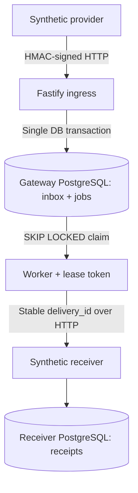

# Case study: recovering signed webhooks without losing or duplicating effects

**Project:** [Webhook Recovery Lab](https://github.com/franciscovitar/webhook-recovery-lab)

**Role and scope:** personal portfolio engineering project, all data synthetic.
Node.js 24, TypeScript, Fastify, PostgreSQL 17, Docker Compose, Vitest and
GitHub Actions. This is an educational system that demonstrates failure
boundaries; it is **not** evidence of operating a production service.

## The engineering problem

A provider can retry a webhook, a network timeout can hide a successful
delivery, and a worker can crash between a receiver's commit and its own ACK.
Sending an HTTP `202` before durable persistence risks losing an event.
Treating every retry as a new operation risks applying the same side effect
more than once.

The goal was to make those cases observable and testable with real databases,
while keeping the application small enough to explain in an interview.

## Architecture and invariants

1. The gateway writes the inbox row and delivery job in **one transaction**.
   It acknowledges only after commit. A unique `(provider,event_id)` key
   deduplicates identical redelivery and rejects changed bytes with `409`.
2. Workers use short row-locked claims. HTTP happens **after** releasing the
   database transaction. Expired leases are reclaimable, and a fencing token
   prevents a stale worker from overwriting the new owner's state.
3. Transient statuses trigger bounded exponential retry with jitter. Five
   attempts are allowed per generation; unrecoverable work goes to `DEAD`.
   Manual replay increments a generation and records an audit row.
4. There is **no distributed transaction** between gateway and receiver.
   At-least-once physical HTTP delivery is expected. The receiver enforces
   one durable effect per stable `delivery_id` in its own database.

## Failure evidence

| Scenario                              | Expected invariant                                | How it was checked                        |
| ------------------------------------- | ------------------------------------------------- | ----------------------------------------- |
| 20 simultaneous identical webhooks    | One inbox row and one job                         | PostgreSQL integration tests              |
| Same event ID, changed signed body    | Conflict `409`; no second job                     | HTTP and database assertions              |
| Job insert fails after inbox insert   | Whole transaction rolls back; retry can succeed   | Injected PostgreSQL trigger test          |
| Six workers competing                 | Only one claim wins                               | Real concurrent PostgreSQL connections    |
| Receiver returns `503`, then succeeds | Retries recorded, one receipt                     | Integration tests and HTTP demo           |
| Worker crashes after remote success   | Two sends but one effect                          | Lease reclaim and receiver receipt checks |
| Expired lease and stale ACK           | Older fencing token cannot commit                 | Two sequential worker ownerships          |
| `422` or exhausted retry budget       | `DEAD`; no uncontrolled retry                     | Integration tests, replay audit           |
| Operator fixes fault and replays      | Monotonic attempt sequence, new generation        | Integration test and HTTP demo            |
| API and worker as separate containers | Eventually one succeeded job and receiver receipt | Docker Compose CI smoke                   |

The deterministic scripted HTTP scenario uses two real PostgreSQL databases
and checks ingress, retries, crash recovery, and replay without printing
nondeterministic database IDs. The separate Compose smoke test builds and
starts the complete multi-service stack and checks the durable outcome.

## Commit-linked evidence (requires repository access)

- [CI run #44533501571](https://github.com/franciscovitar/webhook-recovery-lab/actions/runs/44533501571), commit `d66afc7`: 25 unit and 11 PostgreSQL integration tests passed, none skipped; scripted HTTP recovery demo passed.
- [CI run #44534829515](https://github.com/franciscovitar/webhook-recovery-lab/actions/runs/44534829515), commit `f13c1e7`: the same suites and scripted demo passed, then the full Docker Compose stack delivered a signed webhook to one durable receipt and was stopped safely.

The CI workflow checks machine-readable test reports and rejects absent,
skipped or shrinking suites. Local PostgreSQL verification was also performed
in Claude Code on Windows, separately attributed in the
[PR description](https://github.com/franciscovitar/webhook-recovery-lab/pull/1).
The repository is currently private, so recruiters cannot inspect these links
unless visibility or access changes. Review the current commit's own run for
newly added tests; historical results above are not automatically claims
about later changes.

## Tradeoffs and limits

- PostgreSQL was chosen as a durable small-queue implementation to keep
  correctness, schema and failure handling inspectable. It is not presented
  as a universal replacement for a managed message broker.
- Retrying physical sends is not exactly-once transport. Exactly one receiver
  receipt depends on **downstream idempotency** with stable identity.
- Local and CI synthetic credentials, loopback ports, fixed destinations and
  no public administrative API limit the blast radius. No real user data.
- The [security and architecture review](SECURITY_REVIEW.md) records trust
  boundaries, a stricter test-database guard and deployment blockers.
- Structured worker logs and read-only queue diagnostics are available, but
  there is no centralized metrics store, tracing, alerting, retention policy,
  measured SLO or external production deployment.
- Any bounded concurrency probe is a functional exercise on one shared CI
  runner. Its latency/throughput numbers are observations, not a capacity
  estimate, load-test campaign or service guarantee.

## What I would change for a production service

Define traffic and recovery SLOs from real requirements; implement managed
secret storage and rotation, TLS and authentication for administration,
multi-replica deploy/rollback, metrics/tracing/log retention, backups and
restores, capacity tests, security review, data lifecycle and operational
ownership. Those are future directions, **not completed project claims**.
