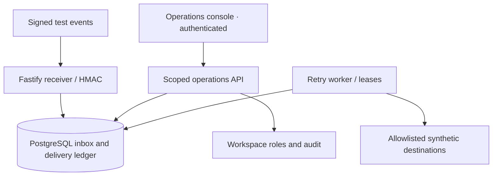

# Webhook Recovery — Product-first operations platform

Status: **owner-approved product goal / proposed design; not yet implemented as a production-like web app**.
Decision date: 2026-11-21 (Argentina).
Repository: private `franciscovitar/webhook-recovery-lab`, baseline `main` `3fa709523caa5e2cd0ac0f8a09bd2e55119424c7`.

## Product intent (persisted)

Turn the existing reliable webhook engine into a **usable integration-operations console** for developers and operations staff: configure endpoints safely, inspect received events, see delivery attempts, understand failures, retry/replay where permitted and follow operational health. Recruiters should encounter a credible SaaS operations product, **not** an explainer animation of HMAC/leases/at-least-once delivery. Technical rigor, architecture, decisions and test evidence live in the [portfolio View Case](https://franvitar.genovasite.com/work/webhook-recovery-lab) and repository docs.

Preserve the existing backend tests and browser-only `showcase/` simulation as engineering QA/reference; replace its role as **the primary public user experience** only after real API/worker/DB integration is ready.

## Real-user jobs and surface

| Role | Product workflow | Expected outcome |
| --- | --- | --- |
| Integration developer | Create an isolated test endpoint, find signing instructions, send a safe synthetic event | A signed event arrives and appears in an event inbox with traceable status |
| Operations engineer | Filter failed/delayed deliveries, inspect sanitized error and timeline, retry one | Status changes from a real worker/DB attempt; retries cannot double-apply consumer effect |
| Team lead | Inspect delivery success, latency/backlog, dead-letter reasons and trend | Operational counts come from persisted state, not static UI counters |
| Workspace admin | Manage roles, safe destination allowlist, signing-key rotation and retention | Only an authorized operator can mutate security or replay settings |
| Read-only reviewer | Explore seeded events and drill into outcomes | Can inspect but not change keys/endpoints or trigger outbound traffic |

## Information architecture

- **Overview:** health, backlog, delivered/failed/late counts, selected time window, contextual incidents.
- **Endpoints:** configured test integrations, signing configuration/status, safe test event action and endpoint activity.
- **Events inbox:** search/filter by status, source, date, event ID; event detail with structured payload preview, signature verdict, dedupe key and timeline.
- **Delivery attempts:** destination, HTTP code, latency, attempt history, next retry, backoff, lease owner/expiration and redacted error.
- **Recovery:** dead-letter queue, scheduled retry, replay with reason/confirmation/idempotency and observable outcome.
- **Operations:** queue status, trends, alerts, retention, role management, audit log and runbooks.

Do not fill the normal dashboard with “what is idempotency?”, “here is the architecture” or a sequence of contrived failure buttons. A test-event tool is a legitimate integration workflow; fault injection belongs to a protected lab/test workspace, not the default operations screen. Public test mode must be clearly but discreetly labeled.

## Reuse and real gaps

| Existing source | Reuse | Gap before public business-like app |
| --- | --- | --- |
| `src/receiver/app.ts`, `src/http/app.ts`, `src/core/signature.ts` | HMAC verification, HTTP ingress, health/ready checks | Authenticated configuration/API; request-size/rate/tenant boundaries |
| `src/core/inbox.ts`, `src/db/postgres-inbox.ts` | Durable inbox/idempotent acceptance | Read/query APIs with scoped redacted data |
| `src/worker/runner.ts`, `src/db/postgres-delivery.ts`, `src/core/delivery.ts` | Leases, processing, retries, delivery state | Operator-controlled safe replay/hold/resume, audit and permission gates |
| `src/bin/{inspect-job,ops-snapshot,replay,send-event}.ts` | Proven operational CLIs | Reuse command/domain logic behind narrow authenticated API, don't shell out from a public UI |
| `migrations/`, `tests/unit`, `tests/integration`, CI | Postgres schema/negative-case verification | Add workspace/RBAC/audit and browser E2E with real worker; keep regressions |
| `showcase/` | Deterministic synthetic visual scenarios | Preserve as separate QA artifact while product console uses live seeded backend state |

**Critical gap:** current HTTP ingress and operational commands are not a publicly authenticated multi-user SaaS interface. Do not expose private repo internals, signing keys, arbitrary target URLs or worker/admin mutation routes merely to make the demo interactive.

## Proposed architecture

- **Keep** Fastify/TypeScript/PostgreSQL and the worker/lease semantics; don't rewrite the engine into an in-browser toy or replace Postgres with a volatile serverless timer.
- Add a separated authenticated operations API: list/query event and delivery, inspect redacted payload, request retries/replays with reason and idempotency, endpoint configuration and audit.
- Add an accessible responsive web frontend (Next/React or small SPA based on verified deployment fit). Frontend state is a **read model** of backend state, not the authority.
- Tenant/workspace isolation is a **new requirement**, not a current capability. Start with one fixed isolated demo workspace and explicit roles; multi-tenant expansion requires dedicated schema/policy tests.
- Signed inbound events, durable deduplication, bounded retries, dead-letter and replay remain server-side. Enforce safe destination scheme, DNS/IP/redirect/allowlist policy to prevent SSRF. In the public version use *only controlled synthetic receiver URLs*, rate limits/quotas and time-bounded data.
- Keep secrets out of responses/logs. Token rotation requires overlap and audit; failed delivery must reveal sanitized diagnostics without exposing full sensitive bodies.

## Invariants and test evidence required

1. Invalid/expired signature cannot enter the inbox; identity replay with changed payload conflicts.
2. An acknowledged event is durably stored even if a worker crashes immediately afterward.
3. Two concurrent workers cannot claim the same lease; expired leases can be reconciled.
4. Retried delivery is at-least-once, while the **consumer effect** is deduplicated by business idempotency key; the UI never promises exactly-once transport.
5. A replay is authenticated, audited, bounded and cannot target arbitrary internet addresses.
6. Cross-workspace events and secrets are invisible to unauthorized readers; read-only users cannot replay.
7. Worker/dependency outage, timeout, 429/500, poison payload and dead-letter recover with observable states, not fabricated green metrics.

## Priority and definition of done

**P0:** genuine receiver/inbox/worker/DB seeded runtime; authentication and safe workspace; events list/detail, delivery timeline, failure queue, replay flow and status filtering; no unauthorized outbound.
**P1:** metrics and charts, key rotation, endpoint configuration, audit/RBAC, alerts, retention/cleanup and download of redacted diagnostics.
**P2:** team invites, usage billing, multiple external providers, arbitrary enterprise connectors and SLO automation only after security, cost and use cases justify them.

Done when a visitor can log into a *restricted public demo*, inspect real persisted test events, generate a signed synthetic event, observe an actual worker delivery/retry/dead-letter and safely replay it. The same build must pass API/database/worker/browser tests, role-denial and SSRF negative cases. This is **not yet delivered**; the current public web experience is a browser-only simulator. Production deployment/provider/spend/security changes require later explicit authority.

## Implementation sequence

1. Characterize existing CLI operations, worker states and schema; preserve tested failure semantics.
2. Design an operations API contract and role matrix; implement read-only views with DB integration.
3. Add bounded replay/test-event commands, audit and negative security tests.
4. Build the console UX atop that API, with seeded persistent test workspace and reset.
5. Run local tests and E2E before a single bounded publication; then update the portfolio View Case with actual evidence.

No production or external endpoint was changed by this design record.
